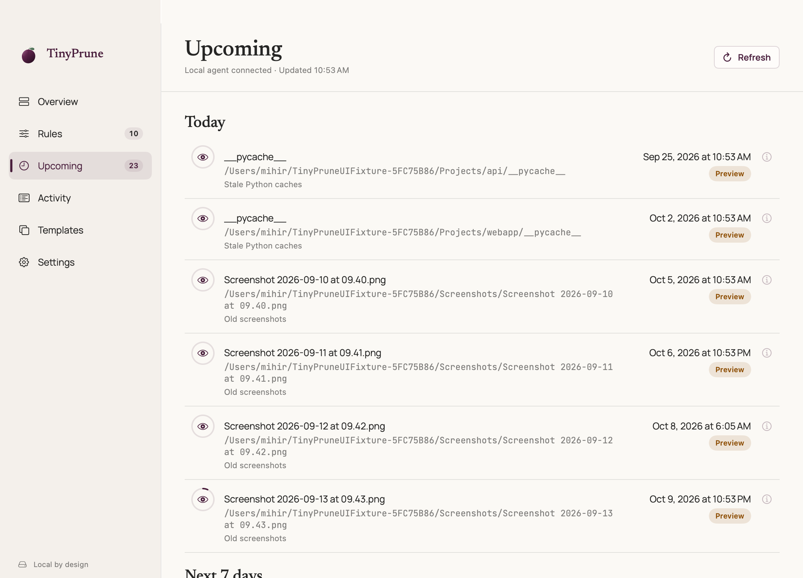

# TinyPrune — automatic file cleanup rules for macOS

[](https://github.com/navig-me/tinyprune/releases)
[](https://github.com/navig-me/tinyprune/releases/latest)
[](https://docs.tinyprune.com/#install)

TinyPrune is a free, MIT-licensed macOS app for automatic file cleanup with expiry rules. Choose folders, preview which downloads, screenshots or developer artifacts will expire, and protect important items with Keep. Eligible items move to **macOS Trash**, never permanent deletion.

**macOS 14+ on Intel and Apple silicon.** macOS is the only supported product; the latest published macOS release is **0.1.13**. **0.2.0 is prepared, not published**, including a Linux/Windows developer preview with no downloads available yet. See the [release log](https://github.com/navig-me/tinyprune/blob/main/RELEASES.md#020) and [cross-platform status](#cross-platform-core).

<p align="center"><a href="https://tinyprune.com"><picture><source media="(prefers-color-scheme: dark)" srcset="website/assets/screens/preview-dark.png"></picture></a></p>

[Website](https://tinyprune.com/) · [Documentation](https://docs.tinyprune.com/) · [Downloads and release notes](https://github.com/navig-me/tinyprune/releases) · [Report a problem](https://github.com/navig-me/tinyprune/issues)

- **Trash only.** Items are moved to Trash, never permanently deleted. Items stay in the Trash until you or macOS empty it; use Finder's *Put Back* to restore, if available.
- **Preview first.** Broad and developer rules start in Preview, and very broad folders (home, `/Users`, `/Volumes`, `/private`, whole volumes) are Preview-only, which schedules and explains matches but never touches a file.
- **Keep always wins.** A kept item is never trashed, and neither is a folder containing one. Keep matches by file identity and falls back to its recorded path.
- **Explained decisions.** Every candidate shows its rule, basis, deadline and overrides.
- **Local and private.** Core cleanup reads filesystem metadata, never file contents, and needs no account or network. The app has no telemetry. Optional update checks use HTTPS and are on by default; the update path depends on how the app was installed, as described below. Installation always requires your confirmation. The website separately uses Google Analytics and PostHog.
- **Three interfaces, one engine.** The app, a Finder menu and the `tinyprune` CLI all talk to the same background agent.

## What can TinyPrune clean up?

| Use case | Starting rule | Important boundary |
|---|---|---|
| Downloads | Top-level DMGs after 7 days, ZIPs after 14, other items after 30 days in the folder | Review files you want to retain and mark them Keep. |
| Screenshots | Screenshot and Screen Shot filenames, 7 days after creation | Choose the folder where your Mac actually saves screenshots. |
| Developer dependencies | `node_modules` and `.venv` after project inactivity | Start in Preview; dependency changes alone do not prove meaningful project activity. |
| Build output | `dist`, `build`, `target`, `coverage`, and `.cache` after 30 days of project inactivity | Match generated folders, not your source or release archives. |
| AI coding-agent leftovers | Dedicated scratch workspace, session logs, edit backups, or debug logs | TinyPrune does not identify which tool created a file. Transcripts and backups may be irreplaceable. |

See the [template reference](https://docs.tinyprune.com/#templates) for defaults, cache risks, and excluded folders, or the [AI agent cleanup guide](https://docs.tinyprune.com/#agents) for scratch work and worktree cautions.

Moving files to Trash does **not** immediately free disk space. TinyPrune does not empty Trash or guarantee recovery after you or macOS empty it. It is a lifecycle-rule utility, not a duplicate finder, antivirus, or system optimizer.

## Install

Requires macOS 14 or later (Intel and Apple silicon).

```sh
brew install --cask navig-me/tap/tinyprune
```

Early releases are **unsigned, not notarized pre-releases**. The Homebrew cask clears quarantine for you. If you download the DMG directly, copy `TinyPrune.app` to Applications, try opening it once, then allow it under System Settings → Privacy & Security → **Open Anyway**. Homebrew installs update only with `brew upgrade --cask tinyprune`.

Key-enabled direct builds support Sparkle updates authenticated by EdDSA-signed feeds, release notes and DMGs, including ad-hoc builds without an Apple account. **Check for new versions** is on by default in Settings; **Update Now** opens the native confirmation dialog and installation is never automatic. Homebrew never constructs Sparkle; Homebrew and direct copies without a public key use GitHub release notices and manual download or `brew upgrade`. The Trash/update interlock remains active, including interrupted-update recovery for matching key-enabled ad-hoc direct targets.

EdDSA does not notarize the app or change first-install Gatekeeper approval. Sparkle replacements are expected not to carry browser-download quarantine, but an actual older/newer end-to-end installation remains unverified. See [ADR 0009](ADRs/0009-eddsa-only-updates-for-adhoc-builds.md) for update trust, private-key loss/rotation and acceptance requirements.

On first launch, approve the background agent under System Settings → General → Login Items & Extensions, and enable the Finder extension there if you want the Finder menu.

### Preview your first cleanup rule

1. Open TinyPrune and authorize a folder you control, such as Downloads.
2. Add a template and leave it in **Preview**.
3. Review **Upcoming** and each item's explanation. Mark anything you want to retain **Keep**.
4. Enable the rule only after the matches and deadlines are right. Pause cleanup whenever needed.

The [installation guide](https://docs.tinyprune.com/#install), [rule guide](https://docs.tinyprune.com/#rules), and [Preview guide](https://docs.tinyprune.com/#preview) explain the workflow. The Finder extension and CLI use the same background agent as the app.

### Inspect and protect from the command line

With the macOS background agent installed and folder access granted:

```sh
tinyprune status
tinyprune upcoming --json
tinyprune why ~/Downloads/example.zip
tinyprune keep ~/Downloads/example.zip
tinyprune pause
tinyprune resume
```

Paths above are examples; use an item inside a folder you already manage. See the [CLI reference](https://docs.tinyprune.com/#cli) for expiry overrides, configuration, JSON output, and exit codes.

## Build from source

```sh
git clone https://github.com/navig-me/tinyprune && cd tinyprune
swift Scripts/package-app.swift
open .build/package/TinyPrune.app
```

Tests: see [AGENTS.md](AGENTS.md#running-tests). Architecture and release process: [PLAN.md](PLAN.md), [ADRs/](ADRs), [.github/DEPLOYMENT.md](.github/DEPLOYMENT.md). Every release (version, artifacts, signing mode, checksums, build number and verification status, including prepared, withdrawn and yanked ones) is recorded in [RELEASES.md](RELEASES.md); the maintainer runbook is [.github/RELEASING.md](.github/RELEASING.md).

## Cross-platform core

**0.2.0 is prepared, not published.** The Swift macOS app remains the only supported product. The Linux x86_64 and Windows x86_64 Rust runtime is a developer preview being prepared for 0.2.0, not an available download or a supported-platform release. No production Rust update feed exists.

Native Linux inotify and Windows `ReadDirectoryChangesW`, filesystem/Trash adapters, stores, IPC, daemon/CLI, developer installs, and the Windows managed updater have been exercised in recorded CI or container runs. The Tauri UI ran against the real agent in Linux aarch64 Docker and on a Windows CI runner. These checks are not desktop acceptance or production release evidence. See the [Rust workspace status matrix](https://github.com/navig-me/tinyprune/blob/main/rust/README.md#status-matrix) for exact environments, evidence and remaining limits, rather than a second copy here.

Swift remains the behavioral reference; shared golden fixtures pin parity ([ADR 0010](ADRs/0010-cross-platform-core-and-golden-fixtures.md)). The Rust agent does not replace the macOS agent. Preparation, intended artifacts and publication prerequisites are recorded in the [release log](https://github.com/navig-me/tinyprune/blob/main/RELEASES.md#020); maintainers follow the [release runbook](https://github.com/navig-me/tinyprune/blob/main/.github/RELEASING.md).

## License

[MIT](LICENSE). Bundled fonts and Sparkle keep their own licenses; see [NOTICE.md](NOTICE.md).

## Rule and CLI behavior

- Globs without `/` match the item name at any depth (like `.gitignore`); globs with `/` match the path relative to the managed folder. Only `*`, `?` and `**` are supported.
- The Downloads and Temporary Workspace templates act on top-level items only.
- CLI exit codes: `0` ok, `64` usage, `65` invalid data, `69` agent unavailable, `70` agent error, `75` timed out/interrupted/busy (the request may have been applied; check `tinyprune status`), `78` config roots not managed. `--json` errors are JSON too.

See [CHANGELOG.md](CHANGELOG.md) for changes.
